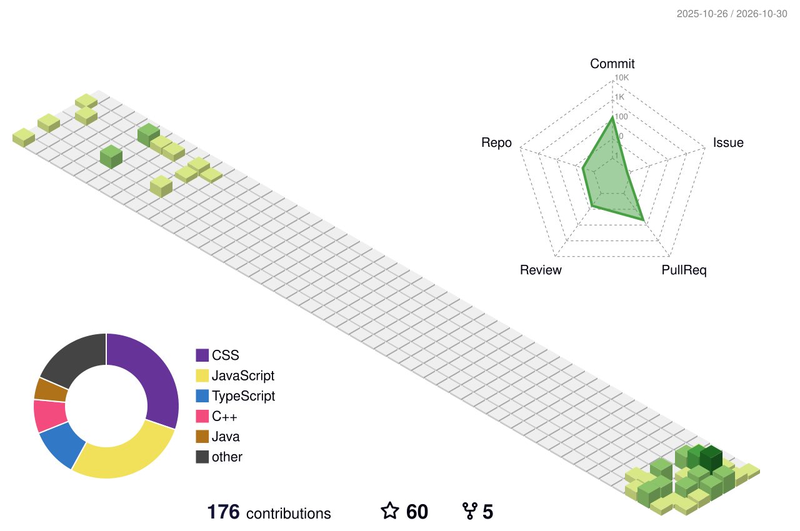

<h1 align="center">Muhammad Hammad Rashid</h1>

<h3 align="center">
  
</h3>

  
  
  

## 👨‍💻 About Me

I'm a Software Quality Assurance Engineer with 3+ years of experience in ensuring the quality and reliability of web applications, mobile apps, and APIs.

I work across manual and automation testing, with hands-on experience in test planning, test execution, API validation, and automation frameworks. I hold a Bachelor's degree in Computer Science and am ISTQB Foundation Level certified.

I'm always interested in exploring better testing practices, improving automation, and collaborating with teams to deliver reliable software products.

I'm open to remote QA opportunities and to collaborating with international teams.

## 🔍 What I Do

- **Manual Testing:** Test planning, test case design, test execution, exploratory testing, and defect management.
- **Automation Testing:** Building and maintaining automated test scripts using Cypress, Playwright, Selenium, and Appium.
- **API Testing:** Validating REST APIs, response structures, status codes, error handling, and data integrity using Postman.
- **Mobile Testing:** Functional, usability, compatibility, and regression testing across real devices, simulators, and emulators.
- **Performance Testing:** Evaluating application performance, response times, and system behaviour using Grafana k6 and JMeter.
- **Requirement Analysis:** Reviewing requirements, specifications (SRS/FRD), and UI/UX designs to identify potential issues before development.

## 🧰 Tech Stack & Tools

### 🤖 Automation & Testing

  
  
  
  

### 💻 Programming Languages

  
  
  
  
  
  
  

### 🔌 API & Network Testing

  
  

### ⚡ Performance Testing

  
  

### 🧪 Test Frameworks & Code Quality

  
  
  

### 🗄️ Database & Web Technologies

  
  
  
  
  

### 🛠️ Development & IDEs

  
  
  
  
  
  
  

### 📋 Project & Test Management

  
  
  
  
  
  

### 🎨 Design & Collaboration

  
  
  
  
  

### 📄 Documentation & Other

  
  
  

## 🧪 Testing Expertise

### Testing Levels
- Component Testing
- Component Integration Testing
- Integration Testing
- System Testing
- System Integration Testing
- Acceptance Testing (UAT)

### Functional & Non-Functional Testing
- Smoke, Sanity, Regression & Re-testing
- Exploratory, Ad-hoc, Monkey & Gorilla Testing
- Functional & Non-Functional Testing
- Alpha & Beta Testing

### Testing Areas
- Web & Mobile Application Testing
- API & Database Testing
- UI/UX & Cross-Browser Testing
- Compatibility & End-to-End Testing

### Performance Testing
- Load Testing
- Stress Testing
- Endurance Testing

### Test Design Techniques
- Boundary Value Analysis (BVA)
- Equivalence Partitioning
- State Transition Testing
- Black-Box, Grey-Box & White-Box Testing

### Static Testing
- Requirements & Design Reviews
- SRS / FRD Analysis
- Documentation Reviews
- Peer & Informal Code Reviews
- Static Code Analysis

## 🔄 Ways of Working

- **Agile:** Scrum and Kanban
- **SDLC models:** Waterfall, V-Model, Agile

## 🎓 Education & Certification

- **B.S. in Computer Science**, National University of Computer and Emerging Sciences
- **ISTQB Certified Tester, Foundation Level**

## ✍️ Writing & Mentoring

- **[Medium](https://medium.com/@muhammadhammadrashidofficial):** I write about software testing, QA best practices, and the evolving role of QA engineers.

## 📂 Repositories

- [QA-RoadMap](https://github.com/MuhammadHammadRashidOfficial/QA-RoadMap)
- [Google Maps API Project](https://github.com/MuhammadHammadRashidOfficial/Maps-Google-Api-Project)
- [Fertilize-Ai](https://github.com/MuhammadHammadRashidOfficial/Fertilize-Ai)
- [Husky](https://github.com/MuhammadHammadRashidOfficial/Husky)

## 📬 Get in Touch

- [LinkedIn](https://www.linkedin.com/in/muhammadhammadrashidofficial)
- [muhammadhammadrashidofficial@gmail.com](mailto:muhammadhammadrashidofficial@gmail.com)

  ## My 3D Contribution Graph

